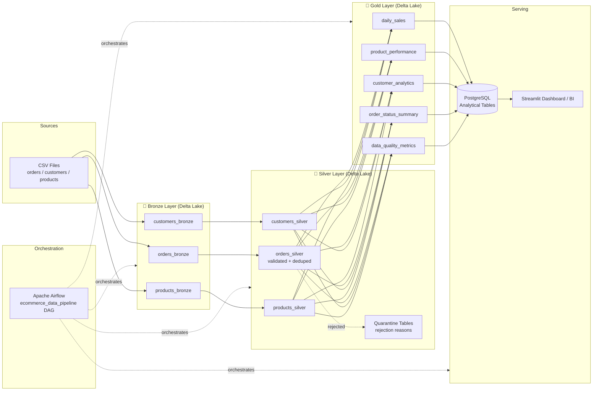

# End-to-End Data Lakehouse Platform

[](https://github.com/yassser0/End-to-End-Data-Lakehouse-Platform/actions)
[](https://www.python.org/)
[](https://delta.io/)
[](https://spark.apache.org/)
[](LICENSE)

A **production-grade, fully executable** e-commerce data engineering project demonstrating:
- Medallion Lakehouse architecture (Bronze / Silver / Gold)
- Apache Spark + Delta Lake transformations
- Apache Airflow orchestration
- PostgreSQL analytical publishing
- Docker-based local environment
- Automated CI/CD with GitHub Actions

> **Status**: All code is real and executable. Limitations are documented in the [Limitations](#limitations) section.

---

## Table of Contents

- [Business Problem](#business-problem)
- [Architecture](#architecture)
- [Technology Stack](#technology-stack)
- [Repository Structure](#repository-structure)
- [Data Model](#data-model)
- [Medallion Architecture](#medallion-architecture)
- [Installation](#installation)
- [Environment Configuration](#environment-configuration)
- [Docker Startup](#docker-startup)
- [Dataset Generation](#dataset-generation)
- [Pipeline Execution](#pipeline-execution)
- [Airflow UI](#airflow-ui)
- [Streamlit Analytics Dashboard](#streamlit-analytics-dashboard)
- [PostgreSQL Connection](#postgresql-connection)
- [SQL Queries](#sql-queries)
- [Running Tests](#running-tests)
- [Troubleshooting](#troubleshooting)
- [Limitations & Future Improvements](#limitations)

---

## Business Problem

An e-commerce company receives transactional data from multiple sources:

- **Orders** — daily CSV exports from the order management system
- **Customers** — customer master data from the CRM
- **Products** — product catalogue from the inventory system

**Challenges:**
- Raw data contains quality issues (duplicates, nulls, invalid values, bad references)
- Data must be validated, cleansed, and enriched before analysis
- Business stakeholders need reliable daily/monthly revenue figures
- Operations needs real-time visibility into order status and quality metrics

---

## Architecture



---

## Technology Stack

| Component | Technology | Version |
|-----------|-----------|---------|
| Processing | Apache Spark / PySpark | 3.5.3 |
| Storage format | Delta Lake | 3.2.1 |
| Orchestration | Apache Airflow | 2.9.3 |
| Analytical DB | PostgreSQL | 16 |
| Language | Python | 3.11+ |
| Containerisation | Docker / Docker Compose | 29+ / v2.40+ |
| Testing | Pytest | 8.x |
| Visualisation / BI | Streamlit / Plotly | 1.66+ / 7.x |
| CI | GitHub Actions | - |
| Data generation | Faker / stdlib | 26.x |

---

## Repository Structure

```
End-to-End-Data-Lakehouse-Platform/
├── dags/
│   └── ecommerce_pipeline.py      # Airflow DAG (7 tasks)
├── src/
│   ├── ingestion/
│   │   ├── extract_csv.py         # CSV → Spark DataFrame with metadata
│   │   └── extract_postgres.py    # JDBC reader (allow-listed tables)
│   ├── transformations/
│   │   ├── bronze.py              # Raw ingestion with MERGE idempotency
│   │   ├── silver.py              # Validation, dedup, quarantine
│   │   └── gold.py                # 5 analytical aggregations
│   ├── quality/
│   │   ├── validation.py          # Pure-Python reusable validators
│   │   └── metrics.py             # Execution metrics accumulator
│   ├── publishing/
│   │   └── postgres_loader.py     # Parameterized bulk insert to Postgres
│   ├── dashboard/
│   │   └── app.py                 # Interactive Streamlit analytics dashboard
│   └── utils/
│       ├── config.py              # All config from env vars (no hardcoding)
│       ├── logging_config.py      # Structured logging with secret redaction
│       └── spark_session.py       # SparkSession factory
├── sql/
│   ├── init.sql                   # PostgreSQL DDL (Gold tables + indexes)
│   └── analytical_queries.sql     # 10 business SQL queries
├── scripts/
│   ├── generate_data.py           # Synthetic dataset generator
│   └── run_pipeline.py            # Full pipeline runner
├── tests/
│   ├── unit/
│   │   ├── test_validation.py     # 56 pure-Python validation tests
│   │   └── test_metrics.py        # 10 metrics tests
│   └── integration/               # Requires Spark (marked separately)
├── data/
│   └── sample/                    # Generated CSVs (git-ignored)
├── docker/
│   └── Dockerfile.spark           # Spark + Delta image
├── .github/
│   └── workflows/
│       └── ci.yml                 # GitHub Actions CI
├── docker-compose.yml
├── requirements.txt
├── pyproject.toml
├── .env.example
├── .gitignore
└── README.md
```

---

## Data Model

### Source Tables (Bronze/Silver)

**orders**

| Column | Type | Description |
|--------|------|-------------|
| order_id | STRING | Business primary key |
| customer_id | STRING | FK → customers |
| product_id | STRING | FK → products |
| order_date | DATE | Order placement date |
| quantity | INTEGER | Units ordered (must be > 0) |
| unit_price | DOUBLE | Price per unit (must be > 0) |
| order_status | STRING | pending / paid / cancelled / refunded |
| payment_status | STRING | unpaid / paid / failed / refunded |
| revenue | DOUBLE | quantity × unit_price (Silver+) |
| _ingestion_timestamp | TIMESTAMP | When row was loaded |
| _source_file | STRING | Origin filename |
| _batch_id | STRING | Pipeline run identifier |

**customers** — customer_id, first_name, last_name, email, country, signup_date, segment

**products** — product_id, product_name, category, unit_price, brand, in_stock

### Gold Tables

| Table | Primary Key | Description |
|-------|------------|-------------|
| gold_daily_sales | order_date | Revenue and paid order count per day |
| gold_product_performance | product_id | Paid revenue and quantity by product |
| gold_customer_analytics | customer_id | Paid spending per customer |
| gold_order_status_summary | order_status | Counts and amounts per status |
| gold_data_quality_metrics | (batch_id, entity) | Quality statistics per batch |

---

## Medallion Architecture

### Bronze Layer
- **Purpose**: Preserve raw source data exactly as received
- **Write mode**: MERGE on `(primary_key, _batch_id)` — idempotent re-runs
- **Metadata added**: `_ingestion_timestamp`, `_source_file`, `_batch_id`
- **Path**: `data/delta/bronze/{entity}`

### Silver Layer
- **Purpose**: Validated, cleansed, business-ready data
- **Validations applied**:
  - Required field null checks
  - Date range validation (2000-01-01 to today)
  - Positive quantity and price enforcement
  - Status canonicalisation (lowercase trim)
  - Referential integrity (customer_id, product_id)
- **Deduplication rule**: Keep most recently ingested row per order_id
- **Invalid records**: Written to quarantine with rejection reason(s)
- **Path**: `data/delta/silver/{entity}`, `data/delta/quarantine/{entity}`

### Gold Layer
- **Purpose**: Analytical aggregations for BI and reporting
- **Revenue definition**: `SUM(quantity × unit_price)` for `order_status = 'paid'` only
- **Write mode**: Full overwrite each run (analytical tables always reflect latest)
- **Path**: `data/delta/gold/{table}`

---

## Installation

### Prerequisites

- Python 3.11+ 
- Java 11+ (required by Spark — `java -version`)
- Docker & Docker Compose v2
- Git

### Local Setup (without Docker)

```bash
# Clone the repository
git clone https://github.com/yassser0/End-to-End-Data-Lakehouse-Platform.git
cd End-to-End-Data-Lakehouse-Platform

# Create and activate virtual environment
python -m venv .venv
# Windows:
.venv\Scripts\activate
# Linux/macOS:
source .venv/bin/activate

# Install dependencies
pip install -r requirements.txt
```

---

## Environment Configuration

```bash
# Copy the template
cp .env.example .env

# Edit .env with your values
# NEVER commit .env to git
```

Key variables:

| Variable | Description | Default |
|----------|-------------|---------|
| `POSTGRES_PASSWORD` | PostgreSQL password | *(must set)* |
| `AIRFLOW__CORE__FERNET_KEY` | Airflow encryption key | *(must set)* |
| `DELTA_LAKE_PATH` | Root path for Delta tables | `data/delta` |
| `DATA_PATH` | Directory containing source CSVs | `data/sample` |
| `LOG_LEVEL` | Logging verbosity | `INFO` |

Generate a Fernet key:
```python
from cryptography.fernet import Fernet
print(Fernet.generate_key().decode())
```

---

## Docker Startup

```bash
# 1. Start PostgreSQL
docker compose up -d postgres

# 2. Initialise Airflow DB and create admin user
docker compose run --rm airflow-init

# 3. Start Airflow
docker compose up -d airflow-webserver airflow-scheduler

# 4. Run the Spark pipeline (one-shot)
docker compose --profile pipeline run --rm spark-pipeline

# Stop everything
docker compose down

# Stop and remove volumes (deletes all data)
docker compose down -v
```

---

## Dataset Generation

```bash
# Generate default dataset (500 customers, 200 products, 5000 orders)
python scripts/generate_data.py

# Custom size with fixed seed (reproducible)
python scripts/generate_data.py --seed 42 --customers 1000 --products 500 --orders 20000

# Output: data/sample/customers.csv, products.csv, orders.csv
```

Injected data quality issues:
| Issue | Rate |
|-------|------|
| Duplicate orders | ~3% |
| Null required fields | ~2-5% |
| Invalid order dates | ~2% |
| Negative quantities/prices | ~2% |
| Invalid customer/product references | ~2% |
| Inconsistent status values | ~4% |

---

## Pipeline Execution

### Local (without Docker)

```bash
# Ensure .env is configured and Java 11+ is installed
python scripts/run_pipeline.py

# Skip PostgreSQL publishing (useful if Postgres is not running)
python scripts/run_pipeline.py --skip-publish

# Use a specific batch ID (for traceability)
python scripts/run_pipeline.py --batch-id 2024-01-15-run1
```

### View latest pipeline summary

```bash
python -c "
from src.quality.metrics import PipelineMetrics
import json
m = PipelineMetrics.load_latest()
print(json.dumps(m, indent=2))
"
```

---

## Airflow UI

Access: **http://localhost:8080** (after `docker compose up`)

- Username: `admin`
- Password: `admin`

The DAG `ecommerce_data_pipeline` appears in the UI. Enable it to run on schedule, or trigger manually.

---

## Streamlit Analytics Dashboard

An interactive dashboard for exploring the Lakehouse Gold analytical tables and data quality metrics:

- **Business Overview**: Total revenue, paid order volume, AOV, active customer count, quality health score.
- **Sales & Revenue**: Date range interactive slider, daily revenue trends, and AOV overlay.
- **Product Insights**: Category revenue share, units sold vs revenue scatter, top 10 products leaderboard.
- **Customer Analytics**: Revenue by segment (Bronze / Silver / Gold), top spending customers.
- **Data Quality & Observability**: Medallion pipeline pass rate and ingested vs quarantined count breakdown.

Access: **http://localhost:8501**

```bash
# Launch dashboard locally
streamlit run src/dashboard/app.py
```

---

## PostgreSQL Connection

```bash
# Via psql
psql -h localhost -p 5432 -U lakehouse_user -d lakehouse

# Via Docker
docker compose exec postgres psql -U lakehouse_user -d lakehouse
```

---

## SQL Queries

See [sql/analytical_queries.sql](sql/analytical_queries.sql) for all 10 queries.

Quick examples:

```sql
-- Daily revenue (last 30 days)
SELECT order_date, total_revenue, paid_order_count
FROM gold_daily_sales
WHERE order_date >= CURRENT_DATE - INTERVAL '30 days'
ORDER BY order_date DESC;

-- Top 5 products by revenue
SELECT product_id, product_name, total_revenue
FROM gold_product_performance
ORDER BY total_revenue DESC
LIMIT 5;

-- Data quality summary (latest batch)
SELECT entity, quality_pct, rejected_count
FROM gold_data_quality_metrics
ORDER BY run_timestamp DESC;
```

---

## Running Tests

```bash
# Unit tests (no Spark required — runs in seconds)
pytest tests/unit/ -v

# Unit tests with coverage report
pytest tests/unit/ --cov=src --cov-report=term-missing

# Integration tests (requires Spark + Java 11)
pytest tests/integration/ -v -m integration

# All tests
pytest -v
```

---

## Troubleshooting

### Spark fails to start
```
Error: java.lang.UnsupportedClassVersionError
```
**Fix**: Install Java 11 (Spark 3.5 requires Java 8 or 11, not 17+)
```bash
java -version   # Must show version 11
```

### Delta Lake JARs not downloaded
```
py4j.protocol.Py4JJavaError: ... delta-spark_2.12
```
**Fix**: Ensure internet access for first run (Spark downloads JARs via Maven). Or pre-download to `~/.ivy2/cache`.

### PostgreSQL connection refused
```
psycopg2.OperationalError: could not connect to server
```
**Fix**: Ensure PostgreSQL is running:
```bash
docker compose up -d postgres
# or
docker compose ps postgres
```

### Airflow Fernet key error
```
ValueError: Fernet key must be 32 url-safe base64-encoded bytes
```
**Fix**: Generate a valid key:
```python
from cryptography.fernet import Fernet; print(Fernet.generate_key().decode())
```

### Pipeline quality check fails
```
RuntimeError: Quality check FAILED for orders: only 45.0% valid
```
**Fix**: Check quarantine tables for rejection reasons:
```python
spark.read.format("delta").load("data/delta/quarantine/orders").show()
```

---

## Limitations

> Features that are **implemented** vs. **planned**:

| Feature | Status | Notes |
|---------|--------|-------|
| Bronze ingestion (CSV) | ✅ Implemented | Idempotent MERGE |
| Silver validation & quarantine | ✅ Implemented | 8 validation rules |
| Gold analytical tables (5) | ✅ Implemented | |
| PostgreSQL publishing | ✅ Implemented | Full refresh |
| Airflow DAG | ✅ Implemented | 7 tasks, XCom passing |
| Streamlit BI Dashboard | ✅ Implemented | Real-time KPIs & charts |
| Unit tests (66 tests) | ✅ Implemented | No Spark needed |
| Docker Compose | ✅ Implemented | Local dev |
| GitHub Actions CI | ✅ Implemented | Unit tests + lint |
| Incremental Spark processing | ⚠️ Not implemented | Currently batch only |
| Spark-Airflow integration test | ⚠️ Manual only | Spark runs as separate container |
| Integration tests | ⚠️ Scaffolded | Require Spark + Docker |
| PostgreSQL JDBC from Spark | ⚠️ Configured | Requires JDBC driver JAR |
| mTLS for PostgreSQL | 🔜 Planned | TODO(security) in code |
| Streaming ingestion | 🔜 Planned | Kafka integration |
| Schema evolution testing | 🔜 Planned | |
| Grafana monitoring | 🔜 Planned | Not yet implemented |

---

## Future Improvements

1. **Incremental processing**: Replace full Bronze reads with Delta CDF (Change Data Feed)
2. **Streaming**: Add Kafka source for real-time order ingestion
3. **Schema registry**: Enforce schema contracts at ingestion
4. **dbt integration**: Model Gold layer with dbt for lineage and docs
5. **Great Expectations**: Add GX checkpoints for automated quality assertions
6. **Kubernetes**: Deploy on K8s with Helm charts
7. **Observability**: Integrate OpenTelemetry traces into Spark jobs

